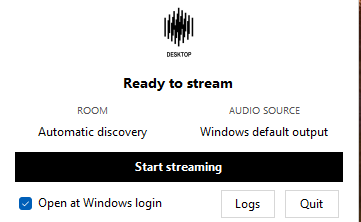

<p align="center">
  
</p>

<h1 align="center">Raumfeld Desktop Stream</h1>

Stream Windows system audio to Teufel Raumfeld speakers over your LAN.
The app captures your playback device through WASAPI loopback, encodes MP3 and
serves it over HTTP. It discovers the room, creates a playback zone if needed,
and starts the speaker. SWYH, Node.js and Raumserver are not required.

## Windows tray and installation

Run `artifacts/installer/Raumfeld-Setup.exe` to install for your Windows user.
It includes the .NET runtime and a Start menu shortcut. No administrator access
is needed. The tray opens at Windows login by default, but streaming starts
only when you press Start streaming. You can turn login startup off in the panel.

Click the tray icon to open the controls. Windows may put it in the overflow
menu. Hover over a room or audio source to read its full name, or over the
status for stream details. Click outside or press Escape to hide the panel.
Quit stops streaming and closes the app. Logs opens the log file in Notepad.

Edit the [configuration file](#configuration) to change rooms or audio devices,
then restart streaming. The app imports configuration from the previous app
name if no current configuration exists. Setup replaces the old startup entry.
Uninstall through Windows Installed apps. Your configuration and logs stay on disk.

To run the tray without installing:

```powershell
.\raumfeld.ps1 build
.\raumfeld.ps1 tray
```

After publishing, run `Raumfeld.Tray.exe` from the publish folder. Pass `--hidden`
to start with only the tray icon, or `--config <path>` to use a configuration file.
Use `Raumfeld.DesktopStream.exe` for CLI commands.

## Build and run

You need Windows 11 x64, an active playback device and a Raumfeld speaker on the
same LAN. Install the [.NET 10 SDK](https://dotnet.microsoft.com/download/dotnet/10.0)
to build. The launcher also detects a local SDK in `.tools/dotnet`.

```powershell
.\raumfeld.ps1 build
.\raumfeld.ps1 doctor
.\raumfeld.ps1 start
.\raumfeld.ps1 status
.\raumfeld.ps1 stop
```

`start` runs in the background and waits until the receiver plays the stream and
fetches audio bytes. Repeated starts reuse the worker. `stop` releases audio and
network resources. It stops speaker playback only when the speaker still has
this app's stream loaded.

```powershell
.\raumfeld.ps1 logs
.\raumfeld.ps1 logs -Follow
.\raumfeld.ps1 run              # Foreground output. Ctrl+C stops the app.
.\raumfeld.ps1 publish
```

Publish produces `artifacts/publish/Raumfeld.DesktopStream.exe` with its .NET
runtime. Copy the whole folder to another Windows x64 machine. The executable
accepts `start`, `stop`, `status`, `doctor`, `logs` and `run`.
The launcher prefers the published copy, so republish after changing source code.

## Configuration

One room needs no configuration. With several rooms, set `roomName` to the name
or UDN shown by `doctor`.

```powershell
Copy-Item raumfeld.example.json raumfeld.local.json
# Edit raumfeld.local.json, then start.
.\raumfeld.ps1 start
```

The launcher reads `raumfeld.local.json` when present. You can also pass
`-Config <path>`. Otherwise, the app looks for
`%LOCALAPPDATA%\Raumfeld.DesktopStream\config.json`.
Use valid JSON. Unknown settings fail validation. Restart to apply changes.

| Setting | Default | Use |
|---|---|---|
| `roomName` | `null` | Select the only room, or match a room name or UDN. |
| `raumfeldHost` | `"auto"` | Discover the host, or use a hostname or IPv4 address. |
| `raumfeldPort` | `47365` | Native Raumfeld host port. |
| `audioDevice` | `"default"` | Default playback device, or an exact name or ID from `doctor`. |
| `localAddress` | `null` | Use the route to the speaker, or set a local LAN IPv4 address. |
| `streamPort` | `0` | Choose a free port, or set a fixed port. |
| `bitrateKbps` | `192` | MP3 bitrate. Supports 96, 128, 160, 192, 224, 256 and 320. |
| `startupTimeoutSeconds` | `90` | Startup deadline, between 10 and 300 seconds. |
| `logLevel` | `"info"` | Use `"debug"` for protocol details and exception stacks. |

The app leaves the Windows output setting alone and keeps the stream alive
during silence. It follows default-device changes and retries a missing device
for 30 seconds. Playback in an existing multiroom zone affects the whole zone.
The HTTP audio stream has no authentication. Keep it on a trusted LAN.

## Latency

MP3 now reaches the encoder in 10 ms blocks, without the file writer's one-second
input buffer. Capture and HTTP queues stay bounded, and the audio clock catches
up when Windows delays a timer tick.

The sender produces its first MP3 output after 30 to 40 ms of input instead of
1,000 ms. This does not measure speaker latency. The controlled acoustic test
still measured about 3.3 seconds through the Stereo M. Earlier sub-second results
were ambiguous because the microphone also heard the local output.

To repeat the measurement, put the default Windows microphone near the speaker
and run this while streaming:

```powershell
.\raumfeld.ps1 latency -Microphone
```

This briefly mutes the Raumfeld output to identify local leakage, restores its
mute state, then compares a test chirp's loopback and microphone timing.
The microphone runs only during this command. Audio stays in memory and is not
saved. The command excludes local leakage when looking for the speaker signal.
Normal streaming captures playback audio only.

## Troubleshooting

Run `doctor` and check `logs`. Log files live in
`%LOCALAPPDATA%\Raumfeld.DesktopStream\raumfeld.log`.

- If discovery fails, check LAN isolation and multicast access, or set
  `raumfeldHost`. Discovery includes unassigned rooms and rooms in standby.
- If the receiver never connects, allow `Raumfeld.DesktopStream.exe` through
  Windows Firewall on your Private network. A local HTTP check cannot prove
  that the speaker can reach the stream.
- If the wrong adapter is selected, set `localAddress` to the PC's LAN address.
  Automatic selection excludes recognized virtual and VPN adapters.
- If capture fails, choose an available playback device from `doctor`. Keep the
  native LAME DLLs beside the executable.
- If a fixed port is occupied, set `streamPort` to `0`.

Exit codes are `0` for success, `1` for an operation failure, `2` for invalid
arguments and `3` when `status` finds no worker.

## Development

The code follows [Microsoft's C# conventions](https://learn.microsoft.com/dotnet/csharp/fundamentals/coding-style/coding-conventions).
`.editorconfig` defines the rules. Builds treat style violations and warnings as
errors. CI checks C# and PowerShell formatting before running tests.

```powershell
.\raumfeld.ps1 format
.\raumfeld.ps1 check
.\raumfeld.ps1 test
.\raumfeld.ps1 test -AudioSmoke
```

The first format or check downloads the pinned PowerShell analyzer into `.tools`.
Tests cover MP3 encoding, HTTP streaming, room and zone parsing, SOAP commands,
playback ownership and worker control. They use a mock receiver.
`-AudioSmoke` also captures the actual Windows output without changing speaker
playback.

The Stereo M has been tested through discovery, zone creation, playback state,
HTTP consumption, acoustic latency and repeated start/stop. Long-session
stability still needs testing.

### Build the installer

Install [Inno Setup 6](https://jrsoftware.org/isinfo.php), then run:

```powershell
.\scripts\Build-Installer.ps1
# Optional: -Compiler C:\path\to\ISCC.exe -Version 1.2.3
```

The script publishes to a fresh folder under `artifacts/package` and writes
`artifacts/installer/Raumfeld-Setup.exe`. It can build while an existing stream
keeps running. The installer is unsigned.

Original code uses the [MIT license](LICENSE). Dependency licenses and the
native encoder's redistribution requirements are listed in [licenses](licenses/README.md).
